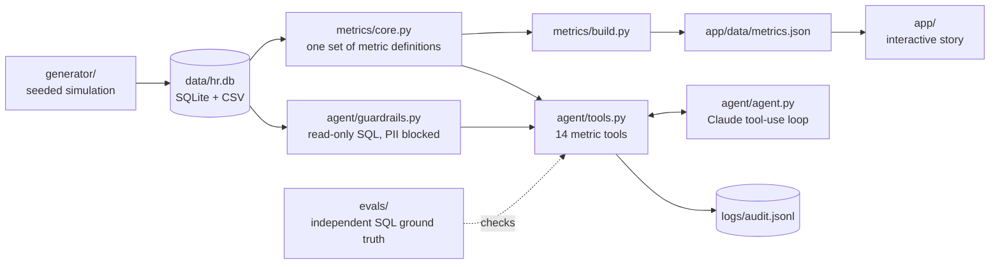

# Workforce Story

**Three years of HR data for a fictional 5,000-person health system, told as a story and queryable by a governed AI agent.**

Cedar Fork Health is an invented regional health system with three hospitals, a clinic network and about 5,000 employees, roughly one in five of whom leave every year. This repository generates its complete HR history (hires, terminations, job changes, requisitions, payroll checks, HR service cases and pay decisions), turns it into a six-chapter interactive story, and puts a Claude tool-calling agent on top of the data with the guardrails a regulated employer would require.

**Live app:** https://workforce.eljuezproductions.com

Everything here is fictional: people, names, organizations and numbers are produced by a seeded simulation.

---

## The story

The app walks from the enterprise view down through each HR function. Every chapter opens with a headline written from the data, so the narrative updates when the data does.

| Chapter | What it shows |
|---|---|
| 1. The enterprise | Headcount, hires and departures, payroll by department, turnover by job family |
| 2. Talent acquisition | Days to fill, recruiting funnel, offer acceptance, source of hire |
| 3. Retention | Monthly turnover (all staff vs nursing), tenure at exit, reasons for leaving |
| 4. Payroll | Overtime rate by pay period, off-cycle corrections, overtime by department |
| 5. HR services | Case volume, SLA, first-contact resolution, time to route a case |
| 6. Compensation | Compa-ratio distribution, pay vs midpoint by family, nurse pay compression |

Filter by fiscal year (FY24–FY26, October to September) and by workforce group (everyone, clinical, non-clinical). Every chart has a data-table view.

### Planted story beats

The simulation includes cause and effect, so the metrics connect across HR domains:

- **Jan–Jun 2025: a competitor recruits nurses.** Nursing turnover climbs to an annualized 28% in May 2025, nursing time to fill stretches past 70 days, and offer acceptance falls.
- **Vacancies become overtime.** Open requisitions in a job family push that family's overtime up, so the recruiting problem shows up in payroll.
- **Feb 2025: payroll system upgrade.** Off-cycle corrections jump from about 4 to over 20 per 1,000 checks, and payroll inquiries to the HR service center more than double.
- **Jul 2025: 6% nursing market adjustment.** Nursing turnover falls afterward, and the gap between new-hire and experienced nurse pay narrows.
- **Oct 2025: AI-assisted triage in the HR service center.** The median time to route a case drops from about 5.5 hours to 20 minutes, first-contact resolution rises, and a virtual agent absorbs some volume.
- **Oct 2025: a new ambulatory clinic opens,** adding a wave of growth hiring.

| | FY24 | FY25 | FY26 |
|---|---|---|---|
| Headcount at year end | 5,035 | 4,984 | 5,099 |
| Turnover | 19.8% | 21.7% | 19.1% |
| Average days to fill | 37.5 | 42.2 | 37.1 |
| Overtime rate (nonexempt) | 5.25% | 5.52% | 5.29% |
| Median hours to route an HR case | 5.45 | 5.47 | 0.33 |

## How it fits together



The dashboard and the agent call **the same metric functions**, so they can never report different numbers for the same question.

## The data

| Table | Rows | What it holds |
|---|---|---|
| `employees` | ~8,200 | Everyone who worked there during the three years, with latest job, pay and termination details |
| `job_history` | ~20,000 | Effective-dated job, department, location, FTE and pay segments |
| `transactions` | ~18,000 | Hires, terminations, promotions, transfers, merit increases, market adjustments |
| `requisitions` | ~3,500 | Backfill and growth requisitions with funnel counts, days to fill and source of hire |
| `payroll` | ~394,000 | One row per employee per biweekly check: regular, overtime, shift differential, bonus and gross pay |
| `payroll_corrections` | ~2,000 | Off-cycle corrections with reasons |
| `hr_cases` | ~24,000 | HR service center cases: category, channel, priority, SLA, resolution time, triage method, CSAT |
| `jobs`, `departments`, `locations` | | 26 jobs with pay ranges, 24 departments, 5 locations |

Metric definitions live in `metrics/core.py` (`DEFINITIONS`). For example, turnover is terminations in the fiscal year divided by average month-end headcount.

## The agent harness

```bash
export ANTHROPIC_API_KEY=...
python -m agent.agent "Why did nursing turnover spike in FY25?"
python -m agent.agent            # interactive
```

The agent answers in plain English by calling tools: 14 curated metric tools, plus `describe_schema`, `metric_definitions` and a guarded `run_sql` for questions the curated tools don't cover. Its system prompt requires every number to come from a tool result.

**Guardrails** (`agent/guardrails.py`):

- **Read-only.** The database opens in SQLite read-only mode, and an authorizer refuses anything but reads: no writes, DDL, `ATTACH` or `PRAGMA`.
- **No PII.** Names, email and birth year are denied at the column level, including inside `SELECT *`. The agent works with employee IDs.
- **Bounded.** One statement per call, 200-row cap, five-second timeout, eight tool rounds per question.
- **Audited.** Every tool call is appended to `logs/audit.jsonl` with inputs, outcome and timing.
- **Fails safe.** Refusals return to the model as tool errors it can explain, never as crashes.

## Evals

```bash
python -m evals.run_evals          # offline: tools vs independent SQL ground truth (runs in CI)
python -m evals.run_evals --live   # end to end: grades the agent's natural-language answers
```

`evals/ground_truth.py` re-implements each metric in plain SQL without importing the metric layer. The offline evals check every curated tool against it, so a bug in either implementation fails the build. The live evals ask the agent each question and pass only when the answer contains the correct number and the agent called a tool instead of guessing.

## Run it locally

```bash
pip install -r requirements.txt
make all        # generate data, run tests and evals, build the dashboard data
make serve      # http://localhost:8000
```

`make test` runs 27 tests covering data invariants (headcount and turnover targets, no overlapping effective-dated history), guardrails and the agent loop with a scripted fake model. CI runs the whole pipeline on every push and fails if the committed dashboard data is stale.

## Deploy to eljuezproductions.com

The app is static (`app/`), so either of these works:

- **Its own Vercel project (simplest):** import this repo in Vercel. `vercel.json` already serves `app/`. Then add a domain such as `workforce.eljuezproductions.com`.
- **Inside an existing site:** copy `app/` into the site's static folder (for example `public/workforce/`).

## Project structure

```
generator/   catalog.py (jobs, departments, reasons), generate.py (the simulation)
metrics/     core.py (metric definitions), build.py (dashboard data and narrative)
agent/       agent.py (tool-use loop), tools.py (tool definitions), guardrails.py
evals/       cases.json, ground_truth.py, run_evals.py
tests/       data, guardrail and agent-loop tests
app/         index.html, styles.css, app.js, data/metrics.json
```

## Limitations

- The data is synthetic. Relationships are planted on purpose and are cleaner than real life.
- Applicant funnels are stored as counts per requisition, not as individual candidates.
- Pay ranges are fixed except for the July 2025 nursing adjustment. There's no annual structure increase.
- The live agent runs from the command line. The web app doesn't call the model.

